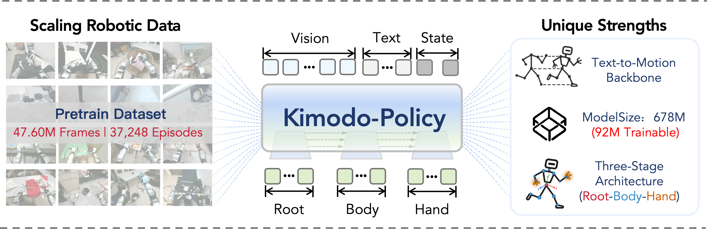

# Kimodo-Policy

**From Text-to-Motion Generators to Humanoid Vision-Language-Action Policies**

Kimodo-Policy adapts pretrained text-to-motion generators into vision–language–action policies for humanoid robots. Given an egocentric image, a language instruction, and motion history, it generates coordinated whole-body actions for closed-loop locomotion and manipulation.

[Project Website](https://kimodo-policy.github.io/) · [Paper](https://github.com/kimodo-policy/kimodo-policy.github.io/releases/download/web-v1/main_arxiv.copy.pdf) · [Code](https://github.com/kimodo-policy/kimodo-policy) · [Models](https://huggingface.co/YunhengWang/kimodo-policy) · [Datasets](https://huggingface.co/datasets/YunhengWang/kimodo-policy)

## Overview

The policy combines a frozen motion backbone with visual ControlNet branches and a dedicated HandNet. Its **root → body → hand** structure connects navigation, articulated body movement, and object interaction, while Dual-Path Fusion grounds motion generation in visual observations.

- **Motion priors:** reuse pretrained whole-body coordination and temporal structure.
- **Efficient adaptation:** 678M total parameters, with 92M trainable parameters in the reported model.
- **Diverse pretraining:** a 419-hour corpus drawn from HIW-500, 14 G1 task subsets of UniFoLM-WBT, and Humanoid Everyday.
- **Simulation and real-world evaluation:** experiments on HumanoidArena, SIMPLE, and eight physical-robot tasks.

## Results and Demonstrations

The project website presents interactive benchmark comparisons and selected demonstrations of object transport, football, pick-and-place, sitting, and other whole-body behaviors. It also introduces the model architecture, pretraining data, and real-world teleoperation setup.

[Explore the results](https://kimodo-policy.github.io/#performance) · [Watch the demonstrations](https://kimodo-policy.github.io/#videos)

## Authors

Yunheng Wang*, Jiaxi Zhang*, Wei Lu*, Yuetong Fang, Taowen Wang, Yixiao Feng, Shuning Zhang, Junzhe Xu, Yichi Wang, Zizhao Yuan, Kailun Huang, Lusong Li, Mingqian Zhou, Zecui Zeng†, and Renjing Xu†.

**Affiliations:** HKUST (GZ), JD Explore Academy, Beijing University of Technology, and University of Cambridge.

\* Equal contribution. † Co-corresponding authors.

## Open-Source Resources

This repository hosts the Kimodo-Policy project website. Training and evaluation code is maintained in the [Kimodo-Policy code repository](https://github.com/kimodo-policy/kimodo-policy); model checkpoints and datasets are available through the Hugging Face links above.
